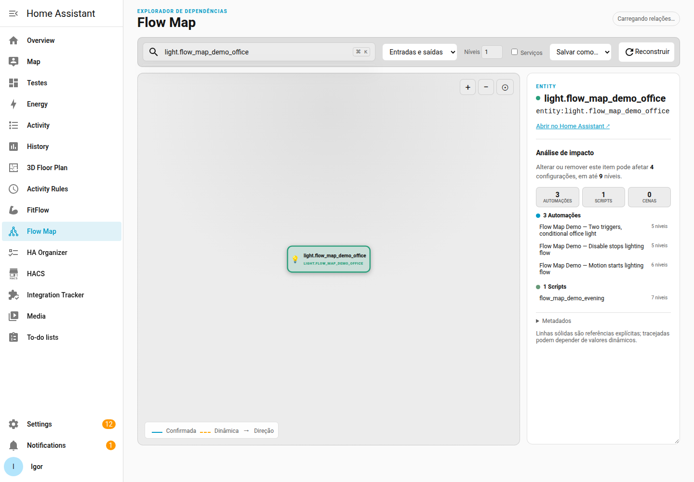
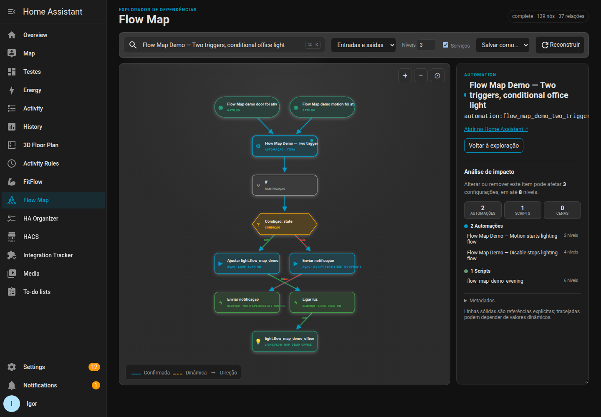

# HA Flow Map

Read-only Home Assistant custom integration that indexes explicit relationships in
automations, scripts and scenes, then exposes them through a `Flow Map` panel.

> See the shape of your smart home before you change it.

HA Flow Map turns scattered automation configuration into a searchable visual
map. Follow what triggers an automation, what it controls, and which other
flows may be affected—without executing templates or changing your setup.

## See it in action

The panel keeps the important context together: the graph, the selected item,
and an impact summary. It also follows the active Home Assistant theme.

  
  

*The screenshots use the included `Flow Map Demo` scenario and show the same
panel in light and dark themes.*

## Why use HA Flow Map?

- **Trace relationships quickly** — search by entity, automation, script,
  scene, event, device, or area.
- **Understand flow structure** — see triggers, conditions, branches, parallel
  paths, waits, service calls, and the order of actions.
- **Assess change impact** — inspect connected configurations and the furthest
  dependency distance before editing an item.
- **Keep uncertainty visible** — dynamic or template-derived references are
  marked instead of being presented as confirmed facts.
- **Stay read-only** — the integration observes supported configuration and
  does not execute templates or modify Home Assistant data.

## A quick tour

1. Search for an item in the Flow Map sidebar.
2. Explore inbound and outbound relationships, adjusting depth as needed.
3. Select an automation, script, or scene to open its complete focused flow.
4. Review the impact summary and export the graph as JSON, SVG, or PNG.

## HACS availability

HA Flow Map is available as a **HACS custom repository**. In HACS, open
**Settings → Custom repositories**, add
`https://github.com/alves-dev/ha-flow-map` with category **Integration**, then
search for **HA Flow Map** and install it. It is not declared as a default HACS
catalog integration.

## Installation

After installing with HACS, restart Home Assistant and add **HA Flow Map** from
**Settings → Devices & services → Add integration**. The panel appears in the
sidebar after configuration.

For manual installation, copy `custom_components/ha_flow_map` into the Home
Assistant configuration directory's `custom_components` folder, restart Home
Assistant, then add the integration through the same screen.

## What it maps

- State/entity triggers, conditions and explicit action targets.
- Nested `if`, `choose`, `repeat`, `parallel`, sequences, waits and delays.
- Script, automation, scene, service and event calls.
- Scene entity states when their configuration is available.
- Entity, device and area targets, with stable namespaced node IDs.

The panel searches the index, expands inbound/outbound neighborhoods (depth
1–3), distinguishes confirmed and dynamic references, and can hide/show service
nodes without changing the stored graph. Rebuild is administrator-only.

Selecting a node also shows an impact summary: the automations, scripts and
scenes connected to it, plus the maximum number of dependency levels. This
walks references in both directions so it catches both callers and targets;
results are bounded to keep the panel responsive.

## Deliberate limits

The integration does not render or execute Jinja templates. Literal entity IDs
found inside templates are retained and marked `dynamic`; unresolved template
results are therefore never shown as confirmed. It currently uses the runtime
automation/script/scene configuration exposed by Home Assistant and reports a
partial index if a source cannot be read.

Dashboard configurations, custom cards, execution traces/history and external
callers (REST, Node-RED, voice assistants, etc.) are not statically indexed in
the current implementation. Their absence from the map means only that no supported source
discovered a relation.

## Technical documentation

Contributor setup, validation, testing and quality checks are in the
[development guide](docs/development.md). Supported Home Assistant releases are
listed in the [compatibility matrix](docs/compatibility.md).

## License

This project is licensed under the [MIT License](LICENSE).
